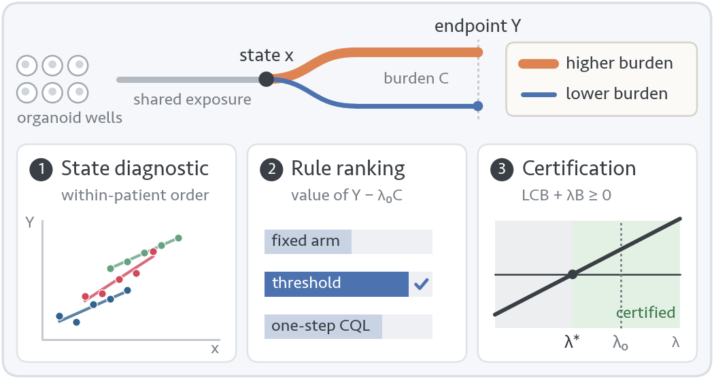
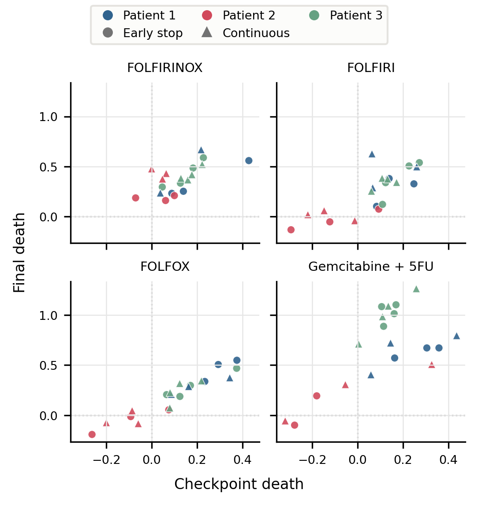
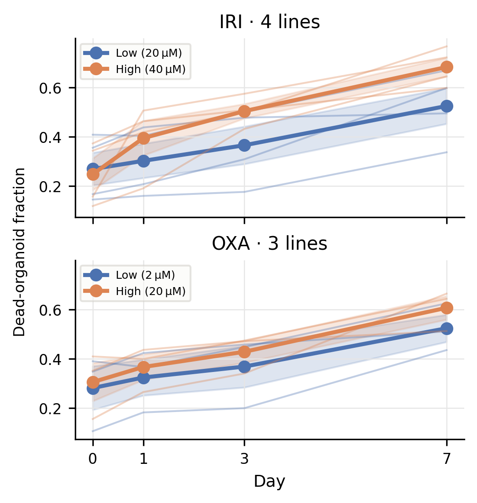
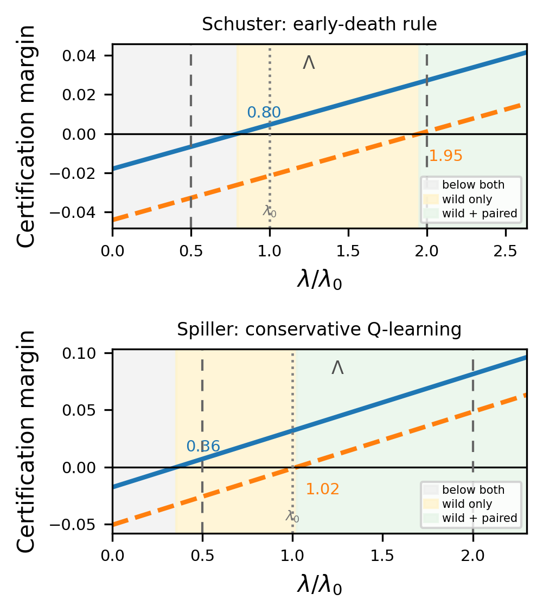
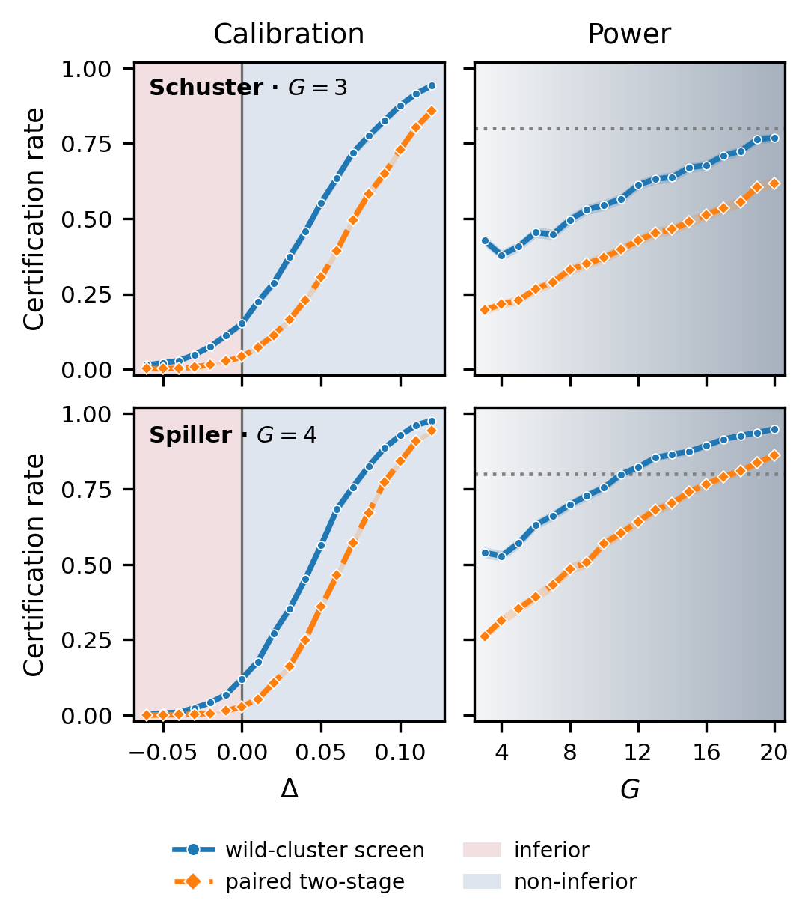

# A Conservative Certification Protocol for Treatment De-escalation in Patient-Derived Organoids

**Yingzhe Qin, Yu Shrike Zhang, Ming Shao** · IEEE BIBM 2026 Workshop on Artificial Intelligence for Precision Medicine (AI4PM)

  

<p align="center">
  
</p>

When can treatment burden be reduced without giving up tumor killing? Patient-derived organoids pose this question for an individual tumor in the laboratory, but public organoid screens provide only a few patients and a single decision point. This repository implements a protocol that answers it at that decision point. A lower-burden rule may replace the higher-burden baseline when a patient-clustered lower confidence bound on its endpoint loss stays within an allowance that grows with the burden it saves. The certificate is the critical exchange rate **λ\***, the lowest price of burden at which the rule qualifies, read against the break-even rate **λ₀** of the two fixed arms.

## The certificate

For a lower-burden rule with endpoint contrast $\delta$ against the baseline and burden saving $B$,

$$M(\lambda) = \mathrm{LCB}_{0.95}(\delta) + \lambda B \ge 0 \quad\Longleftrightarrow\quad \lambda \ge \lambda^\ast = \frac{-\mathrm{LCB}_{0.95}(\delta)}{B}.$$

The bound comes from a paired two-stage cluster bootstrap over patients with 50,000 resamples, and a wild-cluster bound with exact sign enumeration serves as a screen. The three stages ask what the decision-point state supports, retain one of three prespecified lower-burden classes (the fixed low arm, family-specific thresholds on the state, and one-step conservative Q-learning) by the patient-weighted doubly robust value of $Y-\lambda_0 C$, and certify the retained rule. A ratio λ\*/λ₀ below one means the rule clears the bar even below the data's own break-even.

## Benchmark

Each slice observes both arms after a shared checkpoint, a state read before the arms diverge, and a final efficacy endpoint on the same wells.

| Slice | Tumor | Burden | Lower vs higher burden | State *x* | Endpoint *Y* | Patients | Episodes |
| --- | --- | --- | --- | --- | --- | ---: | ---: |
| Schuster 2020 | pancreatic | exposure time | stop at 4 h vs continue to 72 h, four regimens | propidium-iodide death at 4 h | death at 72 h | 3 | 78 wells |
| Spiller 2021 | colorectal | dose | irinotecan 20 vs 40 µM, oxaliplatin 2 vs 20 µM | dead fraction at day 0 | dead fraction at day 7 | 4 | 42 wells |
| Wells 2026 | luminal breast | radiation dose | 5 vs 30 Gy in five daily fractions | caspase reporter before the first fraction | caspase reporter at day 14 | 5 | 708 organoids |

<p align="center">
  
  
</p>
<p align="center"><em>Left, Schuster: within each patient, wells with higher checkpoint death tend to reach higher final death. Right, Spiller: the dose arms overlap before dosing and separate toward day 7.</em></p>

A search of the literature and public data repositories screened 3597 records for this structure and assessed 242 of them against the full text and the released files. Four studies qualified, namely the three slices above and a 2026 preprint (SCOPE) that repeats the Spiller design with a dose series, which is the next replication cohort.

## Results

| Slice | Retained rule | Burden saved | Endpoint change | Paired LCB | λ\*/λ₀ screen | λ\*/λ₀ certificate | λ\*/λ₀ adjusted |
| --- | --- | ---: | ---: | ---: | ---: | ---: | ---: |
| Schuster | family-specific threshold | 26.3 of 72 h (36%) | +0.014 | −0.044 | 0.80 | **1.95** | 2.69 |
| Spiller | one-step conservative Q-learning | 1386 of 5460 µM·h (25%) | −0.003 | −0.051 | 0.36 | **1.02** | 1.36 |
| Wells | fixed 5 Gy arm | 25 of 30 Gy (83%) | +0.029 | −0.003 | 0.00 | **0.10** | 0.41 |

Endpoints are log-ratio death for Schuster, dead fraction for Spiller, and log-ratio caspase signal for Wells. The adjusted certificate accounts for retaining one of three classes.

<p align="center">
  
</p>

- **Exposure duration (Schuster).** The threshold rule continues wells whose checkpoint death is low for their family and stops the rest. It saves 26 of 72 hours and certifies once a context accepts a loss of 0.044 in log-ratio death for those hours, at 1.95 times the break-even rate.
- **Dose intensity (Spiller).** The rule removes a quarter of the dose with no measurable endpoint change and certifies from 1.02 times the break-even rate. Its value comes from the patient level, since it keeps on the high dose the one line whose final dead fraction would drop by 0.30 under full de-escalation.
- **Radiation dose (Wells).** Applied unchanged, the protocol finds that 30 Gy adds no apoptosis over 5 Gy in four of five patients. The paired bound allows a loss of at most 0.003 for 25 Gy less radiation, so the 5 Gy arm certifies at 0.10 times the reference rate.

The audit classes, which comprise state-free rules, a CQL penalty sweep, a random-forest T-learner, and depth-limited policy trees, all certify later than the retained chemotherapy rules. `out/results/audit.csv` holds the full comparison.

## How far three to five patients go

<p align="center">
  
</p>

Data-calibrated simulations rerun the bounds, the doubly robust estimator, and Stage 2 retention on known-truth data matched to each slice.

| Slice | Patients | Paired certificate at the boundary | Wild screen at the boundary | Any certification after selection, paired / adjusted | Power at the observed effect | Patients for power 0.8 |
| --- | ---: | ---: | ---: | ---: | ---: | ---: |
| Schuster | 3 | 4.2% | 15.1% | 8.8% / 4.8% | 0.20 | more than 20 |
| Spiller | 4 | 2.8% | 12.0% | 5.7% / 2.5% | 0.31 | 18 |
| Wells | 5 | 5.7% | 9.8% | 1.5% / 0.3% | 0.86 | 4 |

At the observed heterogeneity the paired certificate stays near its nominal 5% level, while the wild screen passes 10% to 15% of boundary trials, which is why it serves only as a screen. About 18 patients would give power 0.8 for the Spiller effect.

## Reproduce

```bash
pip install -r requirements.txt   # Python 3.14
bash run_all.sh
```

`run_all.sh` downloads the three public cohorts (about 22 MB) into `out/raw` and rebuilds every table and figure, as PDFs for the paper and PNGs in `docs/` for this page. A rerun leaves every committed output byte-identical. The protocol takes about 5 minutes on one core and the simulations about 15 minutes on 14 cores. Compile the paper with `latexmk -pdf main.tex` in `paper/overleaf_ready`.

| File | Role | Paper |
| --- | --- | --- |
| `prep.py` | downloads the cohorts, builds one table per slice in `out/processed` | Table I, Figs 2-3 |
| `protocol.py` | the three stages, audits, and sensitivity analyses, written to `out/results` | Tables II-IV, Fig 4 |
| `stress_test.py` | data-calibrated simulations, `out/results/stress_*.csv` | Fig 5 |
| `fig1_overview.py` | the schematic overview | Fig 1 |
| `dataset_search.py` | the documented search for qualifying public cohorts, `out/search` | Section III |

Each row of `out/processed/*.csv` is one well, or one tracked organoid for Wells, with its patient, treatment family, logged arm (`low` or `high` burden), burden, state, second state channel, and endpoint. The `prep.py` docstring defines each column per slice.

## Data sources

The processed tables are derived from the following public releases and remain subject to their terms. Please cite the original studies.

- **Schuster** (pancreatic cancer, exposure duration). Schuster et al., *Nat. Commun.* 11:5271 (2020), source-data workbook, sheet "Figure 5a-b", published with the article under CC BY 4.0.
- **Spiller** (colorectal cancer, dose intensity). Spiller et al., *Front. Oncol.* 11:771173 (2021), `data/consolidated.csv` in [eitm-org/organoid_drug_response](https://github.com/eitm-org/organoid_drug_response). Copyright 2021 The University of Southern California, released for educational, research, and non-profit use.
- **Wells** (luminal breast cancer, radiation dose). Wells et al., *Sci. Rep.* 16:7928 (2026), `Figure 6/excelFilesZip.zip` in [JanesLab/WellsCJ_OrganoSeg2](https://github.com/JanesLab/WellsCJ_OrganoSeg2).

## Dataset search log

`dataset_search.py` reruns the queries and writes `queries.csv` and `records.csv`. `screening.csv` holds one row per record with the stage at which it left and the reason, and `studies.csv` groups the full-text assessments by study. Title, abstract, and full-text screening against the criteria in the `dataset_search.py` docstring was carried out with Claude (Anthropic) agents, and the qualifying cohorts were checked against their released files.

## Citation

```bibtex
@inproceedings{qin2026certification,
  title     = {A Conservative Certification Protocol for Treatment De-escalation in Patient-Derived Organoids},
  author    = {Qin, Yingzhe and Zhang, Yu Shrike and Shao, Ming},
  booktitle = {IEEE International Conference on Bioinformatics and Biomedicine (BIBM), Workshop on Artificial Intelligence for Precision Medicine},
  year      = {2026}
}
```

## License

The [MIT License](LICENSE) covers the code, the result tables in `out/results`, and the search log in `out/search`. The processed tables in `out/processed` keep the terms of their sources above, and the paper source in `paper/` keeps the authors' copyright, which transfers to IEEE on publication.
